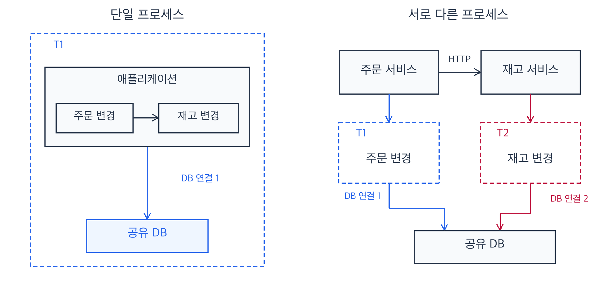
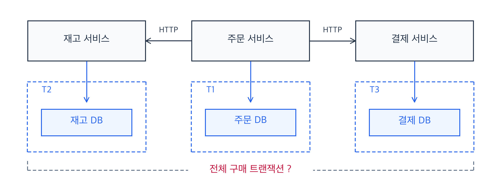
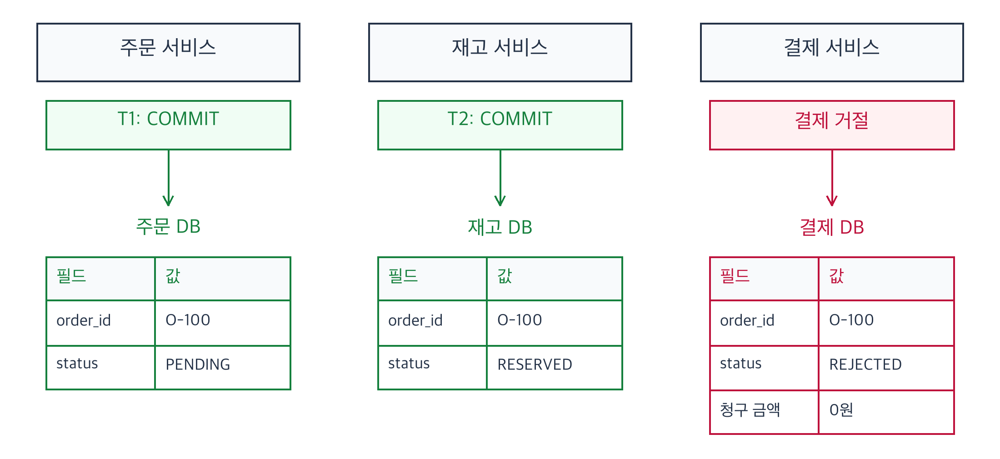

> 이 시리즈는 분산 트랜잭션과 Saga를 공부하며 정리한 내용을 다룹니다. 실제 운영 경험을 소개하는 글이 아니라, 학습을 위한 가상의 주문, 재고, 결제 예제로 서비스 간 데이터 일관성을 유지하는 방법을 살펴봅니다. 2PC와 Saga의 비교에서 시작해 Saga를 구현할 때 필요한 상태 저장과 보상, 장애 후 재개를 다루고, 취소와 예약 만료, 여러 작업의 복구까지 조건을 추가하며 설계를 구체화하는 과정을 다룹니다.

## 분산 트랜잭션은 왜 필요할까

일반적인 RDB의 로컬 트랜잭션은 하나의 DB 연결에서 시작해, 그 트랜잭션에 포함한 변경을 함께 커밋하거나 롤백한다. 모든 변경이 확정되거나 아무 변경도 확정되지 않도록 하는 성질이 **원자성**이다. 같은 서버 애플리케이션에서 주문 저장과 재고 변경을 동일한 트랜잭션에 포함했다면, 재고 변경에 실패했을 때 주문 저장도 함께 롤백할 수 있다.

하지만 주문과 재고가 별도 서비스로 나뉘고 HTTP로 통신하면 상황이 달라진다. 주문 서비스는 자신의 DB 연결에서 트랜잭션을 실행하고, 요청을 받은 재고 서비스도 자신의 연결에서 트랜잭션을 실행한다. 일반적인 HTTP 호출이 주문 서비스의 DB 트랜잭션을 재고 서비스에 전달해 하나로 묶어 주지는 않는다. **두 서비스가 같은 DB를 사용하더라도 각자의 연결에서 따로 커밋하면 서로 다른 트랜잭션이다.** 따라서 각 서비스의 로컬 트랜잭션은 자신의 변경을 원자적으로 처리하지만, 여러 서비스에 걸친 비즈니스 로직 전체의 원자성까지 보장하지는 않는다.

이처럼 하나의 처리 흐름이 여러 트랜잭션에 걸치면 **전체 처리 흐름의 성공과 실패를 조정하는 방법**이 필요하다. 각 트랜잭션이 서로 독립적으로 성공할 수 있으므로, 일부만 성공한 경우를 어떻게 처리할지도 정해야 한다. 이것이 이 글에서 다룰 분산 트랜잭션 문제다.

## 주문/결제/재고를 통해 알아보는 트랜잭션 문제

앞의 차이를 주문에 적용해보자. 고객이 30,000원짜리 상품 한 개를 구매하려 한다. 주문을 접수하고, 재고를 예약한 뒤 결제를 처리해야 한다. 재고 예약은 다른 고객이 먼저 가져가지 않도록 수량을 확보하는 작업이며, 아직 배송을 시작한 것은 아니다.

이 글에서는 주문, 재고와 결제를 각각 별도 서비스와 DB로 나눈다. 주문 서비스가 재고 예약을 요청하고 결과를 받은 뒤 결제를 요청하면, 각 서비스에는 독립적인 로컬 트랜잭션이 실행된다.

### 결제가 거절되면 어떤 상태가 남을까?

정상 흐름에서는 주문 접수, 재고 예약과 결제가 차례로 성공한다. 하지만 재고 예약까지 성공한 뒤 결제가 명확하게 거절되면 상태가 달라진다.

그림에서 주문은 `PENDING`, 재고 예약은 `RESERVED`로 저장돼 있지만 결제는 거절됐고 청구 금액은 0원이다. 구매는 완료되지 않았는데 예약은 유지돼, 다른 고객도 그 수량을 주문할 수 없다. 결제 오류를 반환하거나 주문 서비스의 트랜잭션을 롤백해도 이미 커밋된 재고 예약은 해제되지 않는다. 따라서 각 호출의 성공 여부뿐 아니라, 중간에 실패했을 때 **주문 처리 흐름을 어떻게 취소할지도 정해야 한다.**

## 분산 트랜잭션을 처리하는 방법에는 무엇이 있을까?

여러 서비스의 작업을 하나의 처리 흐름으로 연결할 때는 커밋을 어떻게 결정할지부터 선택해야 한다. 참여 자원들이 하나의 전역 커밋 결정에 따르도록 조정하는 방법이 있고, 각자의 커밋을 허용한 뒤 후속 작업으로 성공이나 취소 상태에 도달하는 방법이 있다. 전자는 분산 커밋 프로토콜인 2PC로, 후자는 Saga로 살펴보자. 두 방식이 제공하는 보장과 요구하는 조건은 다르다.

### 2PC: Two Phase Commit

2PC는 조정자가 여러 참여 자원의 커밋을 두 단계로 결정하는 프로토콜이다. 먼저 각 참여자가 커밋할 준비가 됐는지 확인한다. 모두 준비됐으면 커밋을, 준비에 실패한 참여자가 있으면 롤백을 결정해 전달한다.

MySQL InnoDB는 XA 트랜잭션으로 전역 트랜잭션에 참여할 수 있다. 외부 트랜잭션 매니저가 조정자 역할을 맡고, 각 MySQL의 트랜잭션을 `XA PREPARE`로 준비시킨 뒤 결정에 따라 `XA COMMIT` 또는 `XA ROLLBACK`으로 마무리한다. 미완료 준비 상태는 `XA RECOVER`로 확인할 수 있으며, 복구할 때는 조정자가 기록한 전역 결정에 따라 처리해야 한다.

**장점**
- 원자적 커밋을 조정한다. 참여 자원들이 같은 전역 결정에 따라 전체 커밋 또는 롤백으로 완료되도록 한다.
- 참여한 DB 변경은 롤백으로 취소할 수 있다. 커밋 전에 중단이 결정되면, 그 변경을 취소하기 위한 별도의 보상 로직을 작성할 필요가 없다.

**단점**
- 모든 참여 자원이 프로토콜을 지원해야 한다. 일반적인 결제 HTTP API는 호출했다는 이유만으로 XA 참여자가 되지 않는다.
- 잠금 유지 시간이 길어질 수 있다. 준비 후 결정을 기다리는 동안 잠금이 유지될 수 있으므로, 느린 참여자나 통신 지연이 다른 요청에도 영향을 줄 수 있다. MySQL에서는 준비된 XA 트랜잭션의 메타데이터 잠금도 커밋이나 롤백까지 유지된다.
- 장애 복구를 위한 조정 체계가 필요하다. 준비된 참여자가 결정을 받지 못하면, 조정자의 결정 기록을 확인하고 같은 결정으로 완료시켜야 한다.

### Saga

Saga는 여러 로컬 트랜잭션을 연결하는 비즈니스 흐름이다. 각 단계는 자신의 변경을 커밋하고 다음 단계로 진행한다. 이후 진행할 수 없는 실패가 발생하면, 이미 커밋한 변경의 효과를 보상 트랜잭션으로 정리한다. 주문에서는 결제가 거절됐을 때 재고 예약을 해제하고 주문을 취소하는 것이 보상 트랜잭션이다.

**장점**
- 전역 결정을 기다리며 DB 트랜잭션을 유지할 필요가 없다. 각 단계의 로컬 트랜잭션을 짧게 끝내고 다음 요청이나 결과를 기다릴 수 있다.
- 참여 서비스 확장에 유리하다. 각 서비스가 자신의 DB에서 변경을 확정하고 명령이나 이벤트로 연결되므로, 쿠폰이나 배송 서비스를 추가할 때 모든 참여자를 동일한 분산 커밋 프로토콜에 맞출 필요가 없다. 추가 단계의 결과 확인과 보상은 설계해야 한다.
- 실패한 흐름을 개별적으로 복구할 수 있다. 진행 기록을 보존하면 해당 주문의 미완료 단계나 보상을 이어갈 수 있다. 이 실행 기반은 별도로 구현해야 한다.

**단점**
- 중간 상태와 일시적인 불일치가 노출된다. 전체 흐름의 원자적 커밋이나 격리를 자동으로 제공하지 않는다.
- 보상 로직을 직접 설계해야 한다. 이미 발송한 상품처럼 되돌리기 어려운 작업은 별도 취소나 반품 규칙이 필요하며, 보상 자체도 실패할 수 있다.
- 복구와 운영의 복잡도가 커진다. 중복 요청, 순서 역전, 결과 불명과 중단 후 재개를 처리해야 한다.

## 무엇을 선택하는 게 좋을까?

선택의 출발점은 전체 변경을 하나의 원자적 커밋으로 확정해야 하는지, 아니면 처리 중 상태를 허용하고 성공이나 보상 완료로 진행시킬 수 있는지다. 모든 참여 자원이 XA를 지원하고 전역 원자성이 필요한 경우라면 2PC를 검토할 수 있다.

이 시리즈의 주문 시스템에는 다음 조건을 추가한다.
- 주문 요청이 한꺼번에 몰릴 수 있으며, 서로 다른 주문을 병렬로 처리해야 한다.
- 주문, 재고와 결제는 각각의 DB와 배포 주기를 가진다. 이후 쿠폰, 포인트와 배송 서비스가 참여할 수 있다.
- 외부 결제 API는 XA에 참여하지 않지만 거래 결과 조회와 환불을 지원한다고 가정한다.
- 구매 처리 중과 취소 처리 중 상태를 사용자에게 보여 줄 수 있으며, 실패 시 환불과 예약 해제를 통해 취소를 완료할 수 있다.

이 조건에서는 **각 서비스가 로컬 트랜잭션을 짧게 끝내고, 요청과 보상으로 구매 흐름을 조정하는 Saga가 더 적합하다고 판단했다.** 요청이 몰렸을 때 여러 참여자의 전역 결정을 기다리는 준비 상태를 줄이고, 새 참여자를 추가할 때도 같은 커밋 프로토콜 지원을 요구하지 않기 때문이다. 그 대신 중간 상태를 허용하고, 진행 기록과 멱등 처리, 보상 실패의 복구를 설계해야 한다.

이 시리즈에서는 위 조건을 전제로, 먼저 주문 하나를 올바르게 처리하고 이후 여러 주문을 나눠 복구하는 요구사항을 추가해본다.

## Saga의 두 가지 구현 방식

Saga를 구현할 때는 다음 단계와 보상을 누가 결정할지 정해야 한다. 대표적인 방식은 코레오그래피와 오케스트레이션이다.

### 코레오그래피

각 서비스가 다른 서비스의 이벤트에 반응해 자신의 처리를 이어가는 방식이다. 재고 서비스가 주문 접수 이벤트를 받아 재고를 예약하고, 결제 서비스가 재고 예약 완료 이벤트를 받아 결제를 처리하는 식이다. 결제가 거절되면 재고 서비스는 결제 거절 이벤트를 받아 예약을 해제한다.

별도의 중앙 조정자를 구현하지 않아도 되므로 참여 서비스와 단계가 적은 흐름을 간단하게 구성할 수 있다. 다만 흐름이 여러 서비스의 이벤트 처리에 나뉘어 있어, 단계가 늘어나면 전체 실행 순서와 보상 경로를 파악하고 장애 지점을 추적하기 어려워진다.

### 오케스트레이션

조정자가 각 단계의 결과를 받아 다음 명령을 요청하는 방식이다. 조정자가 재고 예약을 요청하고, 예약이 완료되면 결제를 요청한다. 결제가 거절되면 조정자가 예약 해제를 요청한다. 각 서비스는 자신의 DB 변경과 비즈니스 규칙을 처리하고, 조정자는 전체 흐름의 진행과 보상을 관리한다.

실행 순서와 보상 경로를 한곳에서 관리하므로 전체 흐름을 파악하고 변경하기 쉽다. 그 대신 조정자를 구현하고 운영해야 하며, 조정자가 중단되면 처리 중인 흐름도 멈출 수 있어 진행 상태를 보존하고 재개하는 설계가 필요하다.

이번 예제에서는 **오케스트레이션** 방식을 사용한다. 외부 API 호출 전후에 프로세스가 종료되는 상황을 다루려면, 어떤 호출을 시도했고 어떤 결과까지 확인했는지 기록해야 한다. 이 정보를 조정자에서 관리하면 미완료 주문을 찾아 현재 단계부터 진행하거나 보상하는 복구 흐름을 구성하기 쉽다.

## 정리

서비스가 각자의 연결에서 변경을 커밋하면, 한 서비스의 롤백으로 다른 서비스의 변경까지 취소할 수 없다. 이런 분산 트랜잭션 문제에 대해 2PC는 참여 자원의 커밋 결정을 함께 조정하고, Saga는 각 단계의 로컬 커밋과 보상으로 전체 처리 흐름의 일관성을 맞춘다.

이 예제에서는 독립적인 서비스와 외부 결제 API를 연결하고, 참여 서비스가 추가될 수 있으며 처리 중 상태를 허용하는 조건에서 Saga가 더 적합하다고 판단했다. Saga의 구현 방식에는 이벤트로 서비스를 연결하는 코레오그래피와 조정자가 다음 명령을 요청하는 오케스트레이션이 있다.

다음 편에서는 실제 Saga를 실행할 때 생길 수 있는 장애 지점을 하나씩 살펴본다. 예를 들어 결제 API는 성공했는데 결과를 저장하기 전에 애플리케이션이 종료되면, 재시작한 서버는 결제가 실행됐는지 알 수 없다. 이 상황을 복구하려면 호출 전에 의도를 영속화하고, 호출 후 결과를 기록하며, 결과가 불명확한 요청을 확인하거나 같은 작업 키로 안전하게 재시도할 수 있어야 한다. 호출 전후와 결과 저장 사이에서 프로세스를 종료하는 예시를 통해, 중복 결제를 막고 중단된 흐름을 이어가기 위한 조건을 정리해보자.

## Reference

- [MySQL: XA Transactions](https://dev.mysql.com/doc/refman/8.4/en/xa.html)
- [Microservices.io: Saga](https://microservices.io/patterns/data/saga.html)
- [Microsoft: Saga Pattern](https://learn.microsoft.com/en-us/azure/architecture/patterns/saga)
